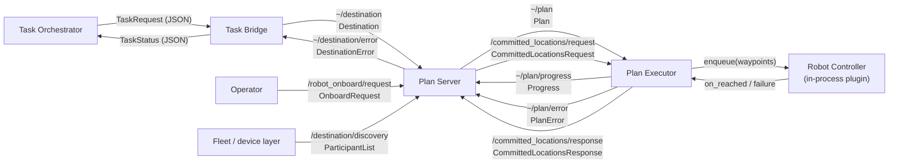
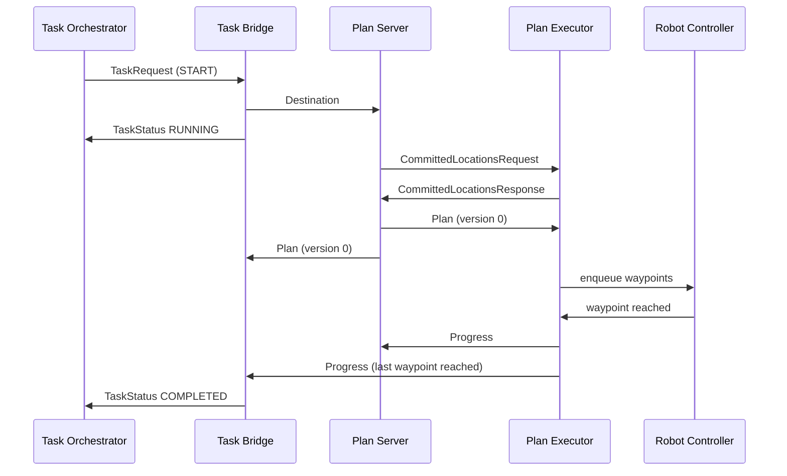
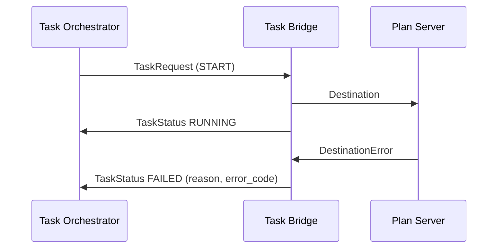

# res_mapf interfaces

Interfaces between modules to process a task from the Task Orchestrator (TO) into a robot movement with result reported.

- **Task Orchestrator (TO)** emits task requests and reads task statuses.. 
- **Task Bridge** translates the orchestrator's JSON task "go to this node" messages into a destination and reports back to the orchestrator
- **Traffic topics** - the Plan Server, Plan Executor and Task Bridge communicate over the topics
- **Plan Server** plans for onboarded robots and publishes one plan per robot. 
- **Plan Executor** tracks Plans and releases waypoints to its robot, holding when the robot needs to wait. It does this through the robot controller interface.
- **Robot controller** interface implements functions to control the robot and report status.

Next-Gen RMF messages are adopted as far as possible. `res_mapf` does not match all these fully yet.


## Terms

| Term | Meaning |
|------|---------|
| Task | TO's request "robot X, go to node N". Has status |
| Destination | The traffic version of a task. Status is derived from Progress, PlanError etc |
| Session | A UUID that identifies one destination. |
| Onboard | To declare that a robot is physically on the floor at a known node so it may be included in planning |

## Overview




## Task statuses

Flow for a successful task:



Flow for a task that fails during planning:



## Interaction with Task Orchestrator (TO)

According to [`interfaces.md`](https://github.com/ros-industrial/rmf2_task_orchestrator/blob/main/docs/interfaces.md), one topic, with payload including `asset_id` to specify the robot.

| Direction | Message  |
|---------|-----------|
| orchestrator to bridge | Task request |
| bridge to orchestrator | Task status |

TODO:
- bridge needs to understand mapping between Task Request fields and traffic fields e.g. `asset_id` <> robot id
- bridge needs to understand asset status reporting to TO.
- Task Request does not specify which map to use. could specify in task_params
- certain Task Request fields may be ignored e.g. `task_expected_start`


```json
{
    "type": "TaskRequest",
    "id": "urn:ngsild:Task:task_GoTo001:TaskRequest",
    "task_type": "GoTo",
    "task_command": "START",
    "asset_id": "agv_1",
    "task_params": {
        "node_id": "P354"
    },
    "timestamp": "2026-10-09T15:30:15Z",
    "task_expected_start": "2026-10-09T15:30:15",
    "task_expected_end": "2026-10-09T15:35:15"
}
```

### Task status

Proposed 

`status`: RUNNING, COMPLETED, FAILED, CANCELLED

`task_params`. on FAILED, to carry `reason`, `error_code`

```json
{
    "id": "urn:ngsild:Task:task_GoTo001:TaskStatus",
    "task_type": "GoTo",
    "status": "FAILED",
    "asset_id": "agv_1",
    "task_params": {
        "node_id": "P354",
        "reason": "failure reason",
        "error_code": 1002,
        "blocked_by": ["agv_2"]
    },
    "timestamp": "2026-10-09T15:30:17Z",
    "task_expected_start": "2026-10-09T15:30:15",
    "task_expected_end": "2026-10-09T15:35:15"
}
```

`error_code` is the code from the [destination error](#destination-errors) or
[plan error](#plan-errors) that caused the failure.


### Mapping from Task Request to Destination.msg

| `Destination` field | Comes from |
|---------------------|------------|
| `session` | Create UUIDv5 from the request `id`, under a namespace from configuration |
| `constraints.nodes[0].key.graph_name` | The bridge's configured `layout_id` |
| `constraints.nodes[0].key.name[0]` | `task_params.node_id` |
| `constraints.nodes[0].key.key` | Left empty |
| `constraints.nodes[0].key.element_type` | `ELEMENT_TYPE_NODE` |
| `constraints.regions` | Left empty |
| `timestamp` | Request `timestamp` |
| `detour_for_goal` | Zero (not a detour) |


## Task Bridge behaviour

An executable bridging TO and `res_mapf` Destinations.

| Topic | Bridge | Used for |
|-------|--------|----------|
| `/robot_onboard/response` | subscribes | Learning which robots have been accepted |
| `/robot_offboard/response` | subscribes | Learning which robots have been removed |
| `~/destination` | publishes | request a destination |
| `~/plan` | subscribes | Latest plan for the session |
| `~/plan/progress` | subscribes | Detecting arrival |
| `~/plan/error` | subscribes | Execution failure |
| `~/destination/error` | subscribes | Planning failure |

### Starting a task (`START`)

The bridge checks the request, publishes one `Destination` and reports `RUNNING`.

| Check | If it fails |
|-------|-------------|
| `asset_id` is an onboarded robot | `FAILED`, reason "unknown asset" |
| `node_id` is present | `FAILED`, reason "missing goal" |
| `id` is not already open with different `task_params` | `FAILED`, reason "task id reused" |

If the same `id` arrives again with the same `task_params` while the task is still open, the bridge
treats it as a redelivery. It does not publish again and just re-sends the current status.

If a new `id` arrives for a robot that already has an open task, the new destination replaces the
old one, as `res_mapf` does today. The old task ends as `CANCELLED` with reason "superseded".

### Working out the status

The traffic layer has no "destination reached" message, so the bridge works out the status from traffic messages.

| Status | When |
|--------|------|
| `RUNNING` | The `Destination` for this session has been published. Sent once. |
| `COMPLETED` | The robot has arrived, as defined under [Progress](#progress) |
| `FAILED` | A `DestinationError` for this session, or a `PlanError` for this session with any code except 2001 and 2002 |
| `CANCELLED` | A cancel was accepted and the robot has arrived at its stop node, or the task was superseded |

A few details matter here:

- Messages for any other session are ignored.
- A `Progress` message is only looked at once the bridge holds the `Plan` with the same `plan_id`.
  While a robot is still finishing waypoints from an older plan version, `Progress` carries the
  older `plan_id`, so the task stays `RUNNING`.
- `PlanError` codes 2001 and 2002 ask for a replan. The Plan Server answers with a new plan version,
  so they are not failures.
- `COMPLETED`, `FAILED` and `CANCELLED` end the task. Each is sent once, the task is closed and the
  asset status goes back to `IDLE`.

### Cancelling a task (`CANCEL`, `STOP`)

The bridge publishes a cancel request for the session and waits for the response with the same
`request_id`.

| Response | What the bridge does |
|----------|----------------------|
| `ACCEPTED` | Waits for the robot to arrive at the returned stop node, then reports `CANCELLED` |
| `ALREADY_FINISHED` | Nothing. `COMPLETED` has already been reported. |
| `UNKNOWN_SESSION` | Reports `FAILED`, reason "unknown task" |

After a cancel the robot is still onboarded and is an obstacle at its stop node.

### Pause and resume (`PAUSE`, `RESUME`)

TODO, not implemented yet in Plan Executor

### Restart
TODO

### Configuration

| Parameter | Purpose |
|-----------|---------|
| Broker connection | MQTT / AMQP host, port, client id |
| Navigation task type | The `task_type` string the bridge accepts |
| `layout_id` | LIF `layoutId` used as `graph_name` for every destination. One layout per bridge. |
| Session namespace UUID | Fixed namespace for deriving the session UUID |
| Asset-to-namespace map | Optional. Only needed when an `asset_id` is not a valid ROS 2 name. |
| Planning timeout | Seconds to wait for a plan before giving up |

## Traffic interfaces

### Conventions

A topic written as `~/plan` means
`/<robot name>/plan` where `<robot name>` should match `asset_id`

Each request gets exactly one response. Responses are public, so other
nodes can listen in; the Task Bridge does this for onboarding.

A location is a `GraphElementKey`:

| Field | Value |
|-------|-------|
| `graph_name` | LIF `layoutId` |
| `name[0]` | LIF `nodeId` |
| `element_type` | `ELEMENT_TYPE_NODE` |
| `key` | Left empty |

Nodes are matched by name, never by grid coordinates.

A destination is identified by a session UUID, chosen by whoever publishes it. Every plan for that
destination carries the session in `plan_id.destination_session`. `plan_id.plan_version` starts at 0
and goes up by one each time the Plan Server replans for the same session.

### Topics

The Origin column says where each message comes from: **NG** is a Next-Gen RMF message used
unchanged, **res_mapf** exists today (possibly reshaped), **New** is a message from the earlier
draft that `res_mapf` does not have yet, and **Proposed** is my own suggestion. Topic names for new
messages are placeholders.

| Topic | Type | Origin | Publisher | Subscribers |
|-------|------|--------|-----------|-------------|
| `/destination/discovery` (latched) | `ParticipantList` | NG | Fleet / device layer | Plan Server, Plan Executor |
| `/robot_onboard/request` | `OnboardRequest` | New | Fleet / device layer | Plan Server |
| `/robot_onboard/response` | `OnboardResponse` | New | Plan Server | Fleet / device layer, Task Bridge |
| `/robot_offboard/request` | `OffboardRequest` | New | Fleet / device layer | Plan Server |
| `/robot_offboard/response` | `OffboardResponse` | New | Plan Server | Fleet / device layer, Task Bridge |
| `~/destination` | `Destination` | NG | Task Bridge | Plan Server |
| `~/destination/error` | `DestinationError` | NG | Plan Server | Task Bridge |
| `~/destination/cancel/request` | `CancelDestinationRequest` | New | Task Bridge | Plan Server |
| `~/destination/cancel/response` | `CancelDestinationResponse` | New | Plan Server | Task Bridge |
| `~/plan` (latched) | `Plan` | NG | Plan Server | Plan Executor, Task Bridge |
| `~/plan/progress` (latched, **Proposed**) | `Progress` | NG | Plan Executor | Plan Server, Task Bridge |
| `~/plan/error` | `PlanError` | NG | Plan Executor | Plan Server, Task Bridge |
| `/committed_locations/request` | `CommittedLocationsRequest` | res_mapf | Plan Server | Plan Executor |
| `/committed_locations/response` | `CommittedLocationsResponse` | res_mapf | Plan Executor | Plan Server |

A latched topic is reliable, transient local, depth 1. All other topics are reliable and volatile.

`TaskRequest`, `TaskStatus`, `TaskStatusUpdate` and the `/fleet/task_status` topic are removed from
`res_mapf`. Tasks only exist on the orchestrator side of the Task Bridge.

### Discovery

`/destination/discovery` lists the robots whose per-robot topics exist. The Plan Server and Plan
Executor use it to know which robot names to create subscriptions and publishers.


### Onboard and offboard

Onboarding tells the Plan Server that a robot is physically on the floor, at a known node. From then
on the robot is part of every plan. If it has no destination, it is a parked obstacle at its node.

Offboarding tells the Plan Server that a robot has physically left the floor.

A robot only leaves through an accepted offboard request. Dropping out of discovery or going quiet
does not offboard it. A robot that is parked but still on the floor stays onboarded, because other
robots still have to drive around it.

### Destination

`~/destination` carries the one node a robot should go to. It replaces `TaskRequest`.
[From task request to destination](#from-task-request-to-destination) shows how the Task Bridge fills
it.

A robot has one open destination at a time. Publishing a destination with a new session replaces the
open one. Publishing a session that is already open or already finished does nothing. The Plan
Server only reads `constraints.nodes[0]`.

Every destination gets an answer, either a `Plan` or a `DestinationError`. That includes a robot
that is already at its goal: it gets a plan with a single waypoint.

### Destination errors

`~/destination/error` says the Plan Server could not produce a plan for a session. `error.message`
is for people and `error.parameters` is JSON.

### Plan

`~/plan` is one robot's route to its current destination, including the points where it has to wait
for other robots.

| Field | How `res_mapf` fills it |
|-------|-------------------------|
| `plan_id` | The destination's session and the plan version |
| `start_time` | When the plan was published |
| `waypoints[0]` | Where the plan starts: the robot's committed location |
| `waypoints[i].position` | Node coordinates in metres |
| `waypoints[i].arrival_constraints.nodes[0].key` | The node, written as in [Conventions](#conventions) |
| `waypoints[i].progress` | Estimated seconds since the start of the session. It always increases, along a plan and from one plan version to the next. |
| `waypoints[i].maps` | `[layoutId]` |
| `waypoints[i].departure_blockers` | Who to wait for before leaving this waypoint. Each entry names a robot, its `plan_id` and the `progress` it must reach. |
| `waypoints[i].departure_trajectory` | Empty on grids, meaning a straight line to the next waypoint. On graphs, `keys` holds the LIF edge to travel. |
| `departure_action`, `arrival_action`, `workflow` | Empty |

### Progress

`~/plan/progress` says how far a robot has got along a plan. Only the Plan Executor publishes it.
It publishes each time the robot reaches a waypoint. TODO: should it publish once when it
accepts a plan, with `reached_waypoint = 0`

| Field | Meaning |
|-------|---------|
| `plan_id` | The plan the indices below refer to |
| `reached_waypoint` | Index, in that plan's `waypoints`, of the last waypoint reached |
| `target_waypoint` | Index of the furthest waypoint handed to the robot so far |
| `progress` | The `progress` value of the reached waypoint |
| `reached_keys` | Empty |

A robot has arrived when `plan_id` is the latest plan for the session and `reached_waypoint` is the
last index of that plan.

### Plan errors

`~/plan/error` reports a problem found while executing a plan.


### Committed locations

A moving robot cannot be replanned from where it is right now, because it is already on its way
somewhere. So before replanning, the Plan Server asks the Plan Executor where each robot is
committed to go, and starts the new plans from there.

```
# CommittedLocationsRequest.msg    /committed_locations/request
string request_id
```

```
# CommittedLocationsResponse.msg   /committed_locations/response
string request_id
CommittedLocation[] committed_locations   # robots that are moving
StationaryRobot[] stationary_robots       # robots that finished their plan and are parked
GraphElementKey[] possible_obstacles      # nodes where a failed robot may be standing
```

```
# CommittedLocation.msg
string name                   # robot name
PlanId plan_id                # plan the waypoint belongs to
uint64 waypoint_index         # index into that plan's waypoints
float32 progress              # progress value of that waypoint
GraphElementKey location      # the waypoint's node
```

```
# StationaryRobot.msg         (Proposed: today the response only lists robot ids)
string name
GraphElementKey location
```

A committed location is the furthest waypoint a robot can no longer avoid reaching. A stationary
robot has reached the end of its plan and is planned around. A possible obstacle is a node a robot
was sent to but never confirmed reaching before its execution failed. It is planned around until that
robot gets a new plan.

Onboarded robots that have not received a Plan yet are not included in the CommittedLocations response from the Plan Executor.

## Robot controller interface

The Plan Executor releases waypoints to each robot through an in-process plugin, a subclass of
`BaseRobotController`. This is a function-call interface. A VDA5050 adapter, a Nav2
adapter or the simulator would each be one implementation of this plugin.

**Executor to controller**

```
enqueue(robot_id: str, waypoints: list[WaypointWithCallback]) -> None
shutdown(interrupted: bool = False) -> None

WaypointWithCallback
    location: Location       # name (LIF nodeId) and x, y in metres
    on_reached: () -> None   # the controller calls this when the robot arrives
    task_id: str             # the session of the plan this waypoint belongs to
```

**Controller to executor**

```
set_failure_callback(callback)       # the executor calls this once at startup
callback(robot_id: str, error_code: PlanErrorCode, details: str)
```

How the plan turns into calls:

- A plan waypoint becomes a `WaypointWithCallback`: the node name and position go into `location`.
  `departure_action` and `arrival_action` are not in use currently.
- The first waypoint of a plan is where the robot already is, so it is never released.
- The executor does not hand over the whole route at once. It releases two waypoints ahead of
  the last one reached, and releases further waypoints only when the robots it depends on have passed their
  `departure_blockers` and the waypoint lies inside the committed part of the plan. A later
  `enqueue` call adds to waypoints still pending.
- The controller drives to waypoints in the order given and calls `on_reached` once for each, in that
  order. The executor then publishes `Progress` and may release more.
- If the controller cannot carry out a request, it calls the failure callback and the executor
  publishes `~/plan/error`.
- `shutdown` is called when execution ends or is interrupted.

